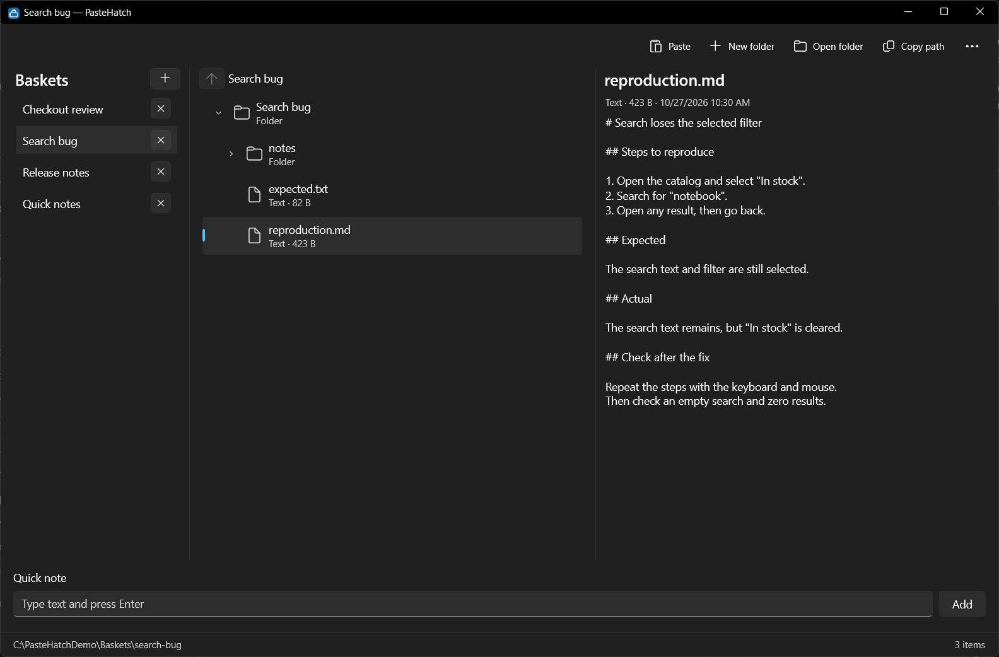

<!-- prettier-ignore -->
<div align="center">


# PasteHatch

Files and clipboard notes for local AI agents.

**[Download](https://github.com/alexkutkin/paste-hatch/releases/latest)** the ready-made
app, extract the ZIP and run `PasteHatch.exe`.

Windows 10/11 · .NET 10 · WinUI 3

</div>

PasteHatch collects text, screenshots, links and files in named baskets. Each basket is
an ordinary folder on your computer. Copy its path and give it to your agent.

<p align="center">
  <a href="docs/images/screenshot.png">
    
  </a>
</p>

## Use

Click the tray icon to open PasteHatch. Pick a basket, then paste with `Ctrl+V` or drop
files into the window. A screenshot becomes a PNG, text becomes a text file, and a web
link becomes a `.url` file. Pasted files and folders keep their contents.

Select a file to preview it. Text and Markdown appear as source; images appear in the
preview panel. The buttons on a tree row open the item or copy its path. **Copy path** on
the command bar copies the current folder's path.

Use the note field at the bottom to save a thought without opening an editor. Press
`Enter` to save it in the current folder.

You can keep up to 10 baskets, rename them and drag them into a different order. Changes
made outside the app appear while its window is open. A folder copied directly into
`Baskets` becomes a basket with the same name, provided there is a free slot.

<p align="center">
  <a href="docs/images/bug-report.png">
    
  </a>
</p>

Both screenshots use made-up files and English labels. English is the default; Russian
is available in Settings.

<details>
<summary>Keyboard shortcuts</summary>

| Action | Shortcut |
| --- | --- |
| Paste | `Ctrl+V` |
| Copy or cut a selected item | `Ctrl+C` / `Ctrl+X` |
| Create a folder | `Ctrl+Shift+N` |
| Rename an item | `F2` |
| Delete an item | `Delete` |
| Go to the parent folder | `Alt+Up` |
| Refresh | `F5` |
| Create or close a basket | `Ctrl+T` / `Ctrl+W` |
| Select a basket | `Ctrl+1` to `Ctrl+8`; `Ctrl+9` selects the last |
| Move a basket in the list | `Ctrl+Shift+Up` / `Ctrl+Shift+Down` |

</details>

Closing the window hides it in the tray. Right-click the tray icon and choose **Exit**
to quit. Settings also has options to start in the tray, remember the window position
and keep the window on top.

## Build and run

Requires Windows 10 version 1809 or later, or Windows 11, and the
[.NET 10 SDK](https://dotnet.microsoft.com/download/dotnet/10.0).
The app includes the Windows App SDK runtime. It needs the .NET 10 Desktop Runtime,
which comes with the SDK.

```powershell
powershell -ExecutionPolicy Bypass -File scripts\build.ps1
powershell -ExecutionPolicy Bypass -File scripts\run.ps1 -Configuration Release
```

The first command builds Release x64. The second builds and launches it. The first
launch opens the window; later launches follow the Start in tray setting. Running the
executable with `--show` opens the window immediately.

To create a desktop shortcut to the Release build:

```powershell
powershell -ExecutionPolicy Bypass -File scripts\install-shortcut.ps1
```

Use `-Uninstall` to remove the shortcut. The build scripts accept `-Platform ARM64`
for an ARM64 build.

## Release ZIP

```powershell
powershell -ExecutionPolicy Bypass -File scripts\package.ps1
```

This builds Debug and Release, runs the tests and writes a versioned x64 ZIP to `dist/`.
Extract the entire folder and run `PasteHatch.exe`. The ZIP includes .NET and the Windows
App SDK, so it needs no separate runtime installation. Your baskets stay in AppData.

## Your files

Data lives in `%LOCALAPPDATA%\PasteHatch`:

| Location | Contents |
| --- | --- |
| `Baskets\` | Basket folders and your files |
| `state.json` | Basket names, order, current folders and window layout |
| `settings.json` | Language and window settings |

Renaming a basket in the app does not change its folder path. Deleting an item or
closing a basket asks for confirmation and sends it to the Windows Recycle Bin.
The last basket cannot be closed.

Losing `state.json` does not delete your files. The app discovers basket folders again
on startup, up to the 10-basket limit. Names stored only in the lost state file cannot
be recovered.

## Limits

The tree supports one selected item at a time. Text previews read the first 65,536
characters. HTML and Markdown are not rendered, and PDFs open in their associated app.
File watching stops while the window is hidden; showing it reads the current contents.

## Development

After code changes, build both configurations. The desktop shortcut uses Release.
Exit the running app before rebuilding it.

```powershell
powershell -ExecutionPolicy Bypass -File scripts\build.ps1 -Configuration Debug
powershell -ExecutionPolicy Bypass -File scripts\build.ps1
dotnet test tests\PasteHatch.Core.Tests
```

The UI smoke check runs against separate test data and restores the clipboard afterward.
Close PasteHatch through the tray first, and avoid copying while it runs.

```powershell
powershell -STA -ExecutionPolicy Bypass -File scripts\verify.ps1 -Configuration Release
```

Results stay in the ignored `.scratch/verify-pastehatch/` folder. See the
[verification guide](.agents/skills/verify-pastehatch/SKILL.md) for coverage and cleanup.

The domain code is in `src/PasteHatch.Core`; the WinUI app and Windows integration are in
`src/PasteHatch.App`. See the [architecture overview](docs/architecture-overview.md) and
[accepted decisions](docs/decisions.md) for more detail.

## License

MIT, see [LICENSE](LICENSE).
