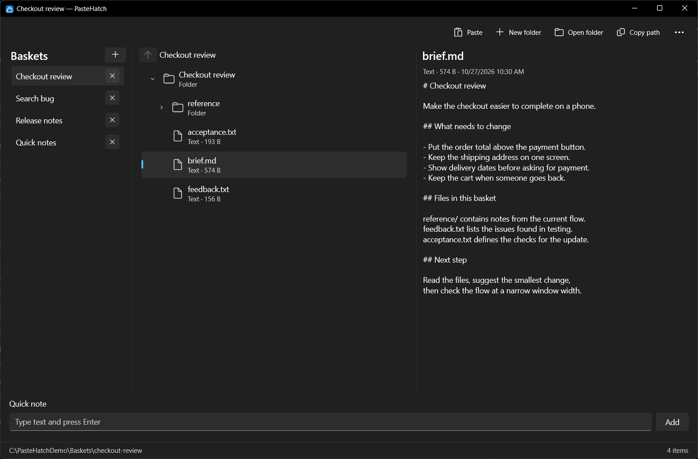

<!-- prettier-ignore -->
<div align="center">


# PasteHatch


Лёгкая Windows-утилита, которая собирает временный контекст для локальных AI-агентов:
файлы, скриншоты, текст и ссылки раскладываются по «корзинам» — обычным папкам на диске.
Без серверов, облака и диалогов сохранения.

[Возможности](#возможности) • [Установка](#установка) • [Использование](#использование) • [Данные](#где-хранятся-данные) • [Устройство](#как-устроено) • [Разработка](#разработка) • [FAQ](#faq)



</div>

PasteHatch живёт в области уведомлений и открывается по щелчку на значке. Всё, что вы
вставляете или перетаскиваете в окно, сохраняется отдельным файлом в папке активной корзины —
эту папку можно передать локальному агенту как есть.

> [!TIP]
> Нажмите «Скопировать путь» на панели команд и передайте путь агенту — он прочитает
> материалы прямо из файловой системы, без экспорта и синхронизации.

## Возможности

- 🧺 **Корзины-папки** — каждая вкладка это отдельная папка `%LOCALAPPDATA%\PasteHatch\Baskets\<UID>`;
  путь виден в строке состояния и копируется одной кнопкой.
- 🗂 **До 10 открытых вкладок** — щелчок переключает, двойной щелчок переименовывает, перетаскивание
  меняет порядок вкладок; открытые корзины, названия, порядок и содержимое восстанавливаются после
  перезапуска.
- 📥 **Универсальная вставка** — `Ctrl+V` или кнопка «Вставить»: скриншот сохраняется как `.png`,
  текст как `.txt`, ссылка как `.url`, файлы из Проводника копируются в корзину.
- 🖱 **Drag & Drop** — файлы можно перетащить прямо в окно.
- 👀 **Превью содержимого** — у `.txt` и `.md` файлов в списке видны первые строки, поэтому файл
  с именем из времени легко узнать, не открывая.
- 📋 **Путь к файлу** — кнопка в каждой строке списка копирует полный путь конкретного материала;
  та же команда есть в контекстном меню строки.
- ✏️ **Переименование** — кнопка в строке, `F2` или двойной щелчок по названию: редактируется
  только имя, расширение видно рядом и не меняется.
- ↕️ **Порядок материалов** — строки перетаскиваются мышью, двигаются с `Alt+↑`/`Alt+↓` или из
  контекстного меню; порядок сохраняется для каждой корзины и переживает перезапуск.
- ✍️ **Быстрая заметка** — `Enter` в поле заметки сохраняет `.txt` с именем по дню недели и
  времени (например `Пн, 13-02.txt`), без диалога сохранения.
- 🧹 **Безопасные действия** — удаление и закрытие корзины проходят через подтверждение и Корзину
  Windows; переименование не меняет расширение.
- 📌 **Трей** — обычный запуск не показывает окно; щелчок по значку показывает/скрывает его и
  всегда поднимает на передний план, правый щелчок открывает меню.
- ⚙️ **Настройки** — запуск в трее, запоминание положения окна и режим «поверх других окон»;
  изменения применяются сразу.
- 🪶 **Нативное Windows-приложение** — стандартные контролы WinUI 3, системная тема, нативные
  контекстные меню и диалоги подтверждения.

## Установка

### Требования

- Windows 10 версии 1809+ или Windows 11 (проверено на Windows 11, сборка 26200).
- [.NET 9 SDK](https://dotnet.microsoft.com/download/dotnet/9.0) — для сборки и запуска из
  исходников. Windows App SDK и WinUI 3 поставляются вместе с приложением
  (`WindowsAppSDKSelfContained`), отдельно устанавливать их не нужно.

### Сборка и запуск

Самый короткий путь — готовые скрипты:

```powershell
powershell -ExecutionPolicy Bypass -File scripts\build.ps1   # Release-сборка, печатает путь к exe
powershell -ExecutionPolicy Bypass -File scripts\run.ps1     # сборка при необходимости и запуск
```

Аргумент `--show` открывает окно сразу, не дожидаясь щелчка по значку в трее. Архитектура —
x64; при необходимости можно собрать ARM64.

<details>
<summary>Сборка вручную (dotnet, ARM64)</summary>

```powershell
dotnet build src\PasteHatch.App\PasteHatch.App.csproj -c Release -p:Platform=x64
.\src\PasteHatch.App\bin\x64\Release\net9.0-windows10.0.19041.0\win-x64\PasteHatch.exe
```

Для ARM64 замените `Platform` на `ARM64`, а `win-x64` на `win-arm64`.

</details>

### Ярлык на рабочем столе

Сборка по умолчанию — framework-dependent: приложению нужен установленный **.NET 9 Desktop
Runtime** (входит в SDK). Ярлык создаётся так:

```powershell
powershell -ExecutionPolicy Bypass -File scripts\install-shortcut.ps1            # ярлык PasteHatch на рабочем столе
powershell -ExecutionPolicy Bypass -File scripts\install-shortcut.ps1 -Uninstall # убрать ярлык
```

Ярлык указывает на `src\PasteHatch.App\bin\x64\Release\...\PasteHatch.exe`; после пересборки
цель не меняется.

## Использование

1. Запустите приложение — первый запуск открывает окно, дальше PasteHatch живёт в трее.
2. Добавьте материалы: `Ctrl+V`, кнопка «Вставить», поле быстрой заметки или перетаскивание.
3. Скопируйте путь к папке кнопкой «Скопировать путь» или путь отдельного файла кнопкой в его
   строке и передайте его агенту.

### Горячие клавиши и жесты

| Действие | Как |
| --- | --- |
| Добавить содержимое буфера | `Ctrl+V` при фокусе в окне или кнопка «Вставить» |
| Добавить файлы | перетащить в окно |
| Выбрать материал | щелчок |
| Открыть материал | двойной щелчок по строке (кроме названия) или `Enter` на выбранном |
| Переименовать материал | кнопка в строке, двойной щелчок по названию, `F2` или контекстное меню |
| Изменить порядок материалов | перетащить строку, `Alt+↑`/`Alt+↓` или контекстное меню |
| Контекстное меню материала | правый щелчок, `Shift+F10` или клавиша меню |
| Скопировать путь к файлу | кнопка в строке материала или пункт «Скопировать путь» контекстного меню |
| Удалить материал | `Delete` (с подтверждением) |
| Переименовать вкладку | двойной щелчок по вкладке, `Enter` — сохранить, `Esc` — отменить |
| Создать/закрыть корзину | `+` в строке вкладок / `×` на вкладке (с подтверждением) |
| Изменить порядок вкладок | перетащить вкладку или `Ctrl+Shift+←`/`Ctrl+Shift+→` |
| Показать/скрыть окно | щелчок по значку в трее |
| Свернуть в трей | закрыть окно (`×` заголовка) или `Alt+F4` |
| Настройки | кнопка «Настройки» на панели команд или правая кнопка по значку в трее |
| Выйти совсем | меню трея «Выход» |

### Превью и заметка

Для текстовых и Markdown файлов список показывает первые две непустые строки — по ним понятно,
что за файл, даже если имя состоит из времени. Чтение ограничено началом файла, поэтому большие
файлы не замедляют список.

Быстрая заметка сохраняется в `.txt` с именем по дню недели и времени. Двоеточие в имени файла
Windows использовать нельзя, поэтому в именах файлов оно заменяется дефисом (`Пн, 13-02.txt`),
а имя вкладки остаётся `Пн, 13:02`.

## Где хранятся данные

| Что | Где |
| --- | --- |
| Материалы корзин | `%LOCALAPPDATA%\PasteHatch\Baskets\<UID>\` |
| Открытые вкладки, их названия, активная вкладка, геометрия окна | `%LOCALAPPDATA%\PasteHatch\state.json` |
| Настройки приложения | `%LOCALAPPDATA%\PasteHatch\settings.json` |
| Корзина удалённых материалов | стандартная Корзина Windows (файлы можно восстановить) |

> [!NOTE]
> Файлы на диске — источник истины: состояние вкладок восстанавливается и по `state.json`, и по
> папкам в `Baskets`, поэтому потеря файла состояния не теряет материалы. Папка корзины названа
> коротким UID (6 символов без похожих `I/O/0/1`), а отображаемое имя вкладки хранится отдельно.

Для автотестов путь данных можно переопределить переменной `PASTEHATCH_DATA_ROOT` (в обычной
работе не задаётся).

## Как это устроено

```
src/PasteHatch.Core     — домен: корзины, материалы, именование, превью, state.json, настройки
src/PasteHatch.App      — WinUI 3: окно, вкладки, список, заметка, настройки
src/PasteHatch.App/Platform — буфер, трей, Корзина Windows, TaskDialog, single instance, Win32
tests/PasteHatch.Core.Tests — xUnit-тесты домена
scripts                 — сборка/запуск/генерация иконки/ярлык/базовый smoke-тест
docs                    — бриф, архитектура, принятые решения, прототип
```

- **PasteHatch.Core** не знает про WinUI: правила (лимит 10 корзин, «последняя вкладка не
  закрывается», коллизии имён, классификация типов, UID, восстановление) и контракты
  `IClipboardReader` / `IShellService` / `IConfirmationService` / `ITabStateStore`. Покрыт
  xUnit-тестами.
- **PasteHatch.App/Platform** реализует контракты нативными средствами Windows: WinForms
  `TaskDialog` / `NotifyIcon` / `Clipboard`, `Microsoft.VisualBasic.FileIO` для Корзины, Win32
  `SetWindowPos` / `SetForegroundWindow` / монитор / pin, `Mutex` + событие для единственного
  экземпляра.
- **PasteHatch.App** — представление: стандартные контролы WinUI 3 (`TabView`, `CommandBar`,
  `ListView`, `TextBox`, `InfoBar`, `MenuFlyout`) и стандартный заголовок окна; системная
  светлая/тёмная тема; отдельное окно настроек.

Подробнее — [`docs/architecture-overview.md`](docs/architecture-overview.md), мотивы решений —
[`docs/decisions.md`](docs/decisions.md).

## Разработка

### Тесты

Юнит-тесты ядра (именование, классификация, состояние, корзины, коллизии, восстановление, превью):

```powershell
dotnet test tests\PasteHatch.Core.Tests\PasteHatch.Core.Tests.csproj
```

Базовый smoke-тест проверяет essentials: запуск, создание корзины и state, окно, добавление текста
через кнопку «Вставить», единственный экземпляр. Окно запускается за пределами экрана, без
активации и без значка в трее:

```powershell
powershell -ExecutionPolicy Bypass -File scripts\smoke.ps1
```

<details>
<summary>Отладочные швы для автоматических проверок</summary>

| Переменная | Назначение |
| --- | --- |
| `PASTEHATCH_DATA_ROOT` | изолированная папка данных вместо `%LOCALAPPDATA%\PasteHatch` |
| `PASTEHATCH_TEST_OFFSCREEN=1` | окно за пределами экрана без активации |
| `PASTEHATCH_TEST_NO_TRAY=1` | приложение не создаёт значок в трее |

В обычной работе эти переменные не задаются, поэтому проверки не мешают пользователю.

</details>

## FAQ

### Почему после запуска не видно окна?

PasteHatch стартует в трее. Щёлкните по значку в области уведомлений — окно появится и выйдет на
передний план. Исключение — самый первый запуск, когда данных ещё нет: окно открывается сразу,
чтобы приложение было легко найти. Принудительно показать окно можно аргументом `--show`.

### Как передать корзину агенту?

Нажмите «Скопировать путь» на панели команд или откройте папку кнопкой «Открыть папку» и передайте
путь агенту. Материалы — обычные файлы, никакого промежуточного формата нет.

### Почему список не обновляется сам, если файл изменили снаружи?

Приложение не использует `FileSystemWatcher`: список обновляется при переключении вкладок,
добавлении материалов и показе окна из трея. Это осознанно — требование live-sync не ставилось,
а лишний сторож файловой системы усложнил бы приложение.

### Можно ли перетащить папку?

Нет: поддерживаются файлы. Вложенную папку откройте в Проводнике и перетащите её файлы. Папки
отклоняются с сообщением, чтобы не копировать произвольные деревья.

### Куда удаляются материалы?

В стандартную Корзину Windows, поэтому файл можно восстановить. Перед удалением приложение
спрашивает подтверждение.

## Известные ограничения

- Последнюю вкладку нельзя закрыть: приложение всегда работает с хотя бы одной корзиной.
- Юнит-тесты покрывают домен; сложные UI-сценарии (диалоги, клавиатурные комбинации, drag & drop)
  проверяются ручными прогонами и базовым smoke-тестом.
- .NET 9 — Standard Term Support: поддержка заканчивается 10.11.2026. Код не использует
  API, привязанных к .NET 9, поэтому переход на .NET 10 LTS — замена целевой платформы
  (`net9.0-windows10.0.19041.0` → `net10.0-windows10.0.19041.0`) после установки SDK 10.

## Ссылки

- [Бриф проекта](docs/discovery/brief.txt) — исходные требования.
- [Архитектура](docs/architecture-overview.md) — границы и схемы C4.
- [Принятые решения](docs/decisions.md) — почему выбраны WinUI 3, трей, подтверждения и как
  проверялись решения.
- [Визуальный прототип](docs/discovery/prototype/README.md) — исходный макет (только как источник
  состава экрана; приложение использует стандартные контролы).
