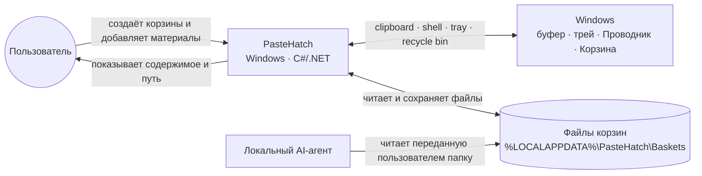
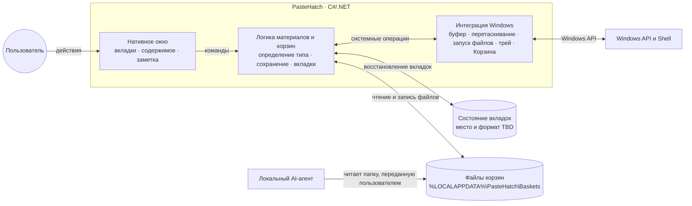

# PasteHatch — краткая архитектура

Схемы выводятся из [брифа](discovery/brief.txt) и прототипа. В репозитории пока нет реализации приложения, поэтому они показывают предлагаемые границы ответственности; UI-фреймворк для .NET и место с форматом хранения состояния вкладок остаются открытыми решениями.

## Контекст системы

PasteHatch — Windows-приложение, которое собирает файлы и содержимое буфера в отдельные корзины. Пользователь и локальный AI-агент работают с этими файлами через `%LOCALAPPDATA%\PasteHatch\Baskets`.

## Внутренние границы приложения

Схемы разделяют внешний контекст и внутренние обязанности приложения, как рекомендует C4 для обзорного уровня; дополнительные уровни добавляются, когда они помогают ответить на конкретный вопрос об архитектуре. См. [C4: виды диаграмм](https://c4model.com/diagrams).
