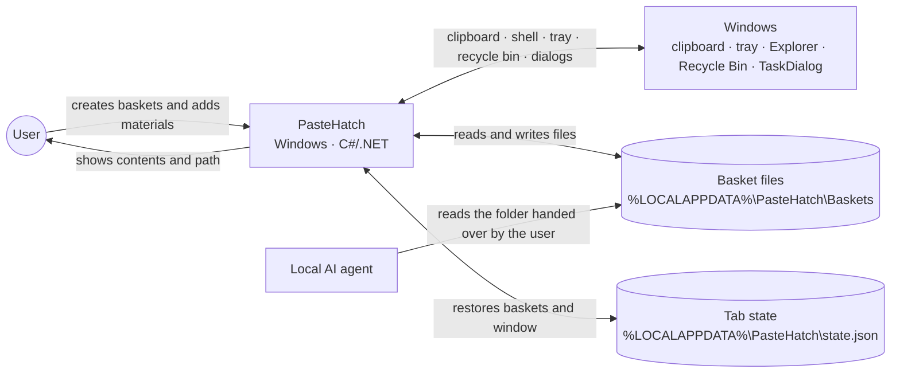
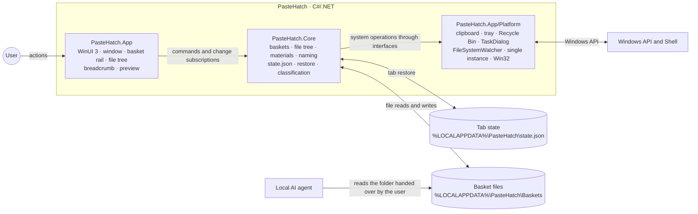

# PasteHatch — architecture overview

The diagrams match the implemented application. Stack and decision rationale:
[decisions.md](decisions.md).

- **Platform:** C#/.NET 10, WinUI 3 + Windows App SDK runtime 2.5.1 (self-contained, no Windows App
  SDK runtime install), Windows 10 1809+ / Windows 11.
- **Storage:** basket folders and a JSON state file in `%LOCALAPPDATA%\PasteHatch`; the
  file system is the source of truth, `state.json` keeps basket order, basket names, the
  active basket, each basket's selected folder and window geometry.

The right panel width is stored in `state.json` as `previewWidth` in logical pixels. It is
saved after a drag ends and restored on startup; in a narrow window the shown width is
clamped to the available space without losing the saved value.

## System context

PasteHatch is a Windows application that gathers files and clipboard content into separate
baskets. The user and a local AI agent work with those files through
`%LOCALAPPDATA%\PasteHatch\Baskets`.

## Internal application boundaries

Responsibility boundaries:

- **File transfer** is concentrated in `FileTransfer`: import, explicit copy and move share
  path checks, collision handling and partial-success handling. `BasketWorkspace` publishes
  the final result and holds the copy/cut intent; the window passes user actions through.
- **Tree state** is held by `BasketTreeNavigation`: selection and expanded folders belong to
  the basket UID, and the current folder is derived from the selection (a selected folder is
  current, a selected file's parent is current), so no other module keeps a copy of it.
  Operations receive the folder explicitly and the state file records it. A vanished selected
  path falls back to the nearest existing parent. WinUI builds nodes lazily, renders the
  breadcrumb prepared by the navigation and reconciles the tree with one call.
- **Live refresh** is coordinated by `WorkspaceRefreshCoordinator`: watcher lifetime depends
  on window visibility and the active basket. A second, nonrecursive watcher observes the
  baskets root; visible folders copied there are adopted as baskets with their original names,
  subject to the 100-basket limit. Stale notifications are dropped, errors cause
  a re-walk. Status messages do not rebuild the tree; content changes defer their own disk
  notifications. `IWorkspaceWatcher` is implemented by OS watching and a controllable test
  variant.

- **PasteHatch.Core** knows nothing about WinUI: the domain rules (the 100-basket limit,
  "the last basket never closes", tree sorting and traversal, name collisions, type
  classification, UID, restore) and the contracts `IClipboardReader` / `IShellService` /
  `IConfirmationService` / `ITabStateStore`. Every basket item is one `BasketEntry` record with
  a kind discriminator, and `RenameEntry` / `DeleteEntry` / `OpenEntry` carry the kind rules
  inside. Covered by xUnit tests.
- **PasteHatch.App/Platform** implements those contracts with native Windows means
  (WinForms `TaskDialog`/`NotifyIcon`/`Clipboard`, `Microsoft.VisualBasic.FileIO` for the
  Recycle Bin, Win32 `SetWindowPos`/monitor/pin, `Mutex`+event for the single instance).
- **PasteHatch.App** is the view: standard WinUI 3 controls (`ListView` rail, `CommandBar`,
  `TreeView`, `BreadcrumbBar`, `TextBox`, `Image`, `InfoBar`, `MenuFlyout`) and the standard
  window title bar; system light/dark theme; a separate settings window on `ToggleSwitch`.
  Layout is three columns: basket rail, file tree, preview. While the window is visible,
  `FolderWatcher` instances listen to changes in the active basket and the baskets root.

The diagrams separate external context from internal duties, as C4 recommends for the
overview level; deeper levels are added when they help answer a specific architecture
question. See [C4: diagram types](https://c4model.com/diagrams).
