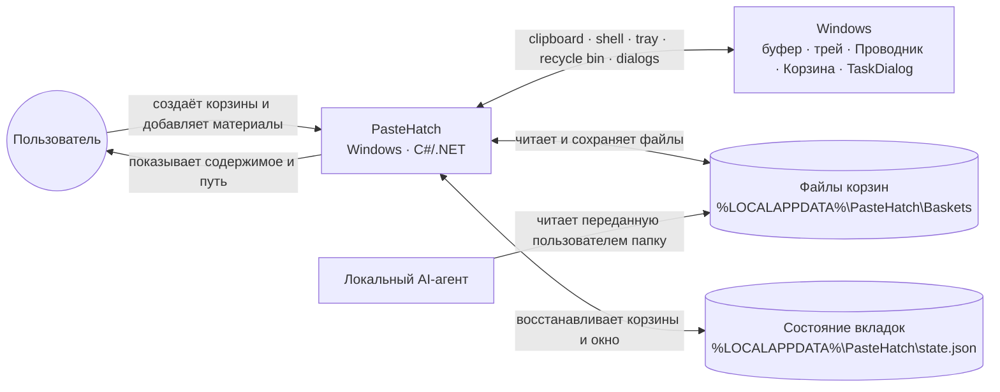
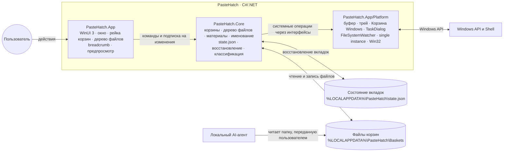

# PasteHatch — краткая архитектура

Схемы выведены из [брифа](discovery/brief.txt) и прототипа и соответствуют реализованному
приложению. Стек и обоснование решений — в [decisions.md](decisions.md).

- **Платформа:** C#/.NET 9, WinUI 3 + Windows App SDK 2.5.1 (self-contained, без установки
  рантайма Windows App SDK), Windows 10 1809+ / Windows 11.
- **Хранилище:** папки корзин и JSON-файл состояния в `%LOCALAPPDATA%\PasteHatch`; файловая
  система — источник истины, `state.json` хранит порядок корзин, их названия, активную корзину,
  выбранную папку каждой корзины и геометрию окна.

## Контекст системы

PasteHatch — Windows-приложение, которое собирает файлы и содержимое буфера в отдельные корзины. Пользователь и локальный AI-агент работают с этими файлами через `%LOCALAPPDATA%\PasteHatch\Baskets`.

## Внутренние границы приложения

Границы ответственности:

- **Перенос файлов** сосредоточен в `FileTransfer`: импорт, явная копия и перемещение используют
  общие проверки путей, коллизий и обработку частичного успеха. `BasketWorkspace` публикует
  окончательный результат и хранит намерение copy/cut; окно передаёт действия пользователя.
- **Состояние дерева** хранит `BasketTreeNavigation`: выбор и раскрытые папки относятся к UID
  корзины, исчезнувший выбранный путь заменяется ближайшим существующим родителем.
  WinUI строит узлы лениво и отображает breadcrumb, подготовленный навигацией.
- **Live-обновления** координирует `WorkspaceRefreshCoordinator`: срок жизни watcher зависит от
  видимости окна и активной корзины; устаревшие уведомления отбрасываются, ошибки вызывают повторный
  обход. Статусные сообщения не перестраивают дерево; изменение содержимого откладывает собственные
  уведомления диска. `IWorkspaceWatcher` реализован OS-наблюдением и управляемым тестовым вариантом.

- **PasteHatch.Core** не знает про WinUI: доменные правила (лимит 10 корзин, «последняя корзина не
  закрывается», сортировка и обход дерева, коллизии имён, классификация типов, UID, восстановление)
  и контракты `IClipboardReader` / `IShellService` / `IConfirmationService` / `ITabStateStore`.
  Покрыт xUnit-тестами.
- **PasteHatch.App/Platform** реализует эти контракты нативными средствами Windows (WinForms
  `TaskDialog`/`NotifyIcon`/`Clipboard`, `Microsoft.VisualBasic.FileIO` для Корзины, Win32
  `SetWindowPos`/монитор/pin, `Mutex`+событие для единственного экземпляра).
- **PasteHatch.App** — представление: стандартные контролы WinUI 3 (`ListView`-рейка, `CommandBar`,
  `TreeView`, `BreadcrumbBar`, `TextBox`, `Image`, `InfoBar`, `MenuFlyout`) и стандартный заголовок
  окна; системная светлая/тёмная тема; отдельное окно настроек на `ToggleSwitch`. Layout — три
  колонки: рейка корзин, дерево файлов, предпросмотр. Пока окно видимо, `FolderWatcher` слушает
  изменения активной корзины.

Схемы разделяют внешний контекст и внутренние обязанности приложения, как рекомендует C4 для обзорного уровня; дополнительные уровни добавляются, когда они помогают ответить на конкретный вопрос об архитектуре. См. [C4: виды диаграмм](https://c4model.com/diagrams).
